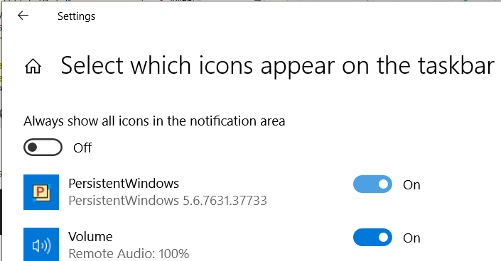

# PersistentWindows
[English](README.md) | **한국어**

이 프로젝트는 Windows 7, 10, 11의 오래된 [문제](https://answers.microsoft.com/en-us/windows/forum/windows_10-hardware/windows-10-multiple-display-windows-are-moved-and/2b9d5a18-45cc-4c50-b16e-fd95dbf27ff3?page=1&auth=1)를 해결합니다. 절전 모드에서 깨어날 때, 외부 모니터를 연결하거나 분리할 때, 모니터 해상도가 바뀔 때(예: 전체 화면 게임 종료), 원격 데스크톱(RDP)에 다시 연결할 때 창 위치가 뒤섞이는 문제입니다. 코드는 [ninjacrab.com/persistent-windows](http://www.ninjacrab.com/persistent-windows/)에서 포크했습니다.

## 원본 설명
> PersistentWindows란?
>
> 이름은 썩 잘 짓지 못했지만, 모니터 개수나 해상도가 바뀔 때 창의 위치와 크기를 기억해 두었다가
이전 설정으로 돌아오면 그대로 복원해 주는 유틸리티입니다.
>
> DisplayPort와 다른 연결 방식을 섞어 여러 대의 모니터를 쓰는 분이라면, 이 도구를 실행해 두기만 하면
모든 것이 정상으로 돌아왔을 때 창을 다시 배치하느라 고생할 필요가 없습니다.

## 주요 기능
- 자동 복원: 창 위치 변화를 계속 추적하고, 작업 표시줄 위치를 포함한 바탕 화면 배치를 마지막으로 일치했던 모니터 구성에 맞게 자동으로 복원합니다.
- 여러 디스플레이 구성의 원격 데스크톱 세션을 지원합니다.
- 새로 열린 창을 마지막으로 닫힌 위치에 즉시 복원합니다. 앱 개발자가 창 위치 기록을 직접 관리하지 않아도 됩니다.
- 디스크에 창 캡처: 바탕 화면 배치를 LiteDB 형식으로 하드 드라이브에 수동 저장합니다. PC를 다시 시작한 뒤에도 닫힌 창을 원래의 가상 데스크톱에 복원할 수 있습니다.
- 스냅샷 캡처: 바탕 화면 배치를 메모리에 수동 저장합니다. 스냅샷에는 창의 Z 순서(겹침 순서)도 보존됩니다. 디스플레이 구성마다 최대 36개([0-9a-z])의 스냅샷을 만들 수 있습니다.
- 모든 창(열려 있는 창과 닫힌 창)의 위치 기록을 XML 형식으로 하드 드라이브에 자동 저장합니다. 덕분에 수동 복원 지점(스냅샷)과 자동 복원 지점이 앱 업그레이드나 재시작, PC 재부팅 뒤에도 그대로 동작합니다.
- 웹페이지 커맨더: vi 편집기처럼 한 글자 명령으로 주요 웹 브라우저의 탐색 효율을 높입니다.
- 전경과 배경의 두 위치 사이를 오가는 효율적인 창 전환.
- 자동 복원 일시중지/재개.
- 특정 프로세스 실행 중 자동 일시중지: 목록에 넣은 프로세스가 실행되는 동안 캡처와 자동 복원을 멈추고, 모두 종료되면 이전 배치를 복원합니다.
- 제외 목록: 지정한 프로세스의 창이나 제목에 지정한 텍스트가 들어 있는 창은 캡처·이동·복원하지 않습니다.
- 한국어를 포함한 다국어 메뉴.
- 자동 업그레이드 지원.
- 더 많은 기능과 명령은 [빠른 도움말 페이지](https://www.github.com/kangyu-california/PersistentWindows/blob/master/Help.md)를 참고하세요.

## 설치
방법 1.
 * 명령 창에서 "winget install PersistentWindows"를 실행합니다. 실제 설치 경로는 c:\users\\[사용자]\AppData\Local\Microsoft\WinGet\Packages\kangyu-california.PersistentWindows.... 이며, **새** 명령 창에서 "PersistentWindows"를 입력해 프로그램을 시작합니다.

방법 2.
- [Releases](https://github.com/kangyu-california/PersistentWindows/releases) 페이지에서 최신 PersistentWindows*.zip 파일을 내려받습니다.
- 원하는 폴더에 압축을 풉니다.
- 폴더 이름에서 버전 번호는 지워도 됩니다. 프로그램이 새 버전으로 업데이트되어도 폴더는 그대로 유지되기 때문입니다.
> 참고: 프로그램은 어느 폴더에서나 실행할 수 있지만, 데이터는 다음 위치에 저장됩니다.
> *C:\Users\\[사용자]\AppData\Local\PersistentWindows*

**관리자 권한으로 실행된 창(작업 관리자, 이벤트 뷰어 등)까지 복원하려면 PersistentWindows도 관리자 권한으로 실행해야 합니다.**

### 로그인할 때 PersistentWindows를 자동으로 시작하도록 설정하기
**작업 스케줄러**에 작업을 만들거나, **시작프로그램 폴더**(shell:startup)에 바로 가기를 추가하면 됩니다.

세 가지 방법 중 **하나**를 고르세요.

**방법 1. 작업 스케줄러 (Windows 10/11)**
* (선택) auto_start_pw_aux.ps1의 두 번째 줄을 편집해 PersistentWindows.exe에 전달할 명령줄 옵션을 바꿀 수 있습니다. 예를 들어 다음 옵션을 덧붙이면 고급 기능이 꺼집니다.
    \+ " -basic_features".
* 설치 폴더로 가서 *auto_start_pw.bat* 파일을 실행하면(가급적 관리자 권한으로) 작업 스케줄러에 작업이 만들어집니다.
        

**방법 2. 작업 스케줄러 (Windows 7/10/11)**
* 설치 폴더에 다음 내용으로 pw.bat 파일을 만듭니다.
```
  start "" /B "%~dp0PersistentWindows.exe" -splash=0
```
* 관리자 권한으로 명령 프롬프트(cmd.exe)를 열고, PW 설치 폴더로 이동(cd)한 다음 아래 명령을 실행합니다.
```
schtasks /create /sc onlogon /tn "StartPersistentWindows" /f /tr "'%~dp0pw.bat'" /rl HIGHEST
REM 높은 DPI 배율 재정의
REG ADD "HKCU\Software\Microsoft\Windows NT\CurrentVersion\AppCompatFlags\Layers" /v "%~dp0PersistentWindows.exe" /t REG_SZ /d "~ HIGHDPIAWARE" /f
```
**방법 3. 시작프로그램 폴더 (Windows 7/10/11)**
* 시작프로그램 폴더에 바로 가기를 만듭니다.
  * `Win + R`을 누르고 `shell:startup` 입력
  * *PersistentWindows.exe*의 바로 가기를 만들어 시작프로그램 폴더에 넣습니다.
* 관리자 권한으로 실행하려면:
  * 바로 가기 대신 .vbs 파일(예: *PersistentWindows as Administrator.vbs*)을 만들고 다음 내용을 넣습니다.
    ```
    Set objShell = CreateObject("Shell.Application")
    objShell.ShellExecute "C:\path\to\PersistentWindows.exe", "", "", "runas", 1
    ```
  * 스크립트의 경로를 *PersistentWindows.exe* 파일의 실제 위치(PersistentWindows 폴더를 저장한 곳)로 바꿉니다.

  <br>

  >  참고: 바로 가기 속성에서 관리자 권한으로 실행하도록 설정할 수도 있지만, 시작프로그램 폴더를 통해 열릴 때는 이 설정이 동작하지 않습니다. 그래서 .vbs 스크립트를 쓰는 우회 방법을 사용합니다.

## 제거
  1단계. uninstall.bat을 관리자 권한으로 실행해 PersistentWindows가 만든 앱 데이터 폴더와 자동 시작 작업을 지웁니다.

  2단계. winget으로 설치했다면 "winget uninstall PersistentWindows"를 실행하고, 아니라면 PersistentWindows.exe가 들어 있는 폴더를 지웁니다.

## 사용 방법
- `PersistentWindows.exe`를 실행합니다(가급적 관리자 권한으로). 이 앱에는 주 창이 없으며, 아이콘은 기본적으로 작업 표시줄의 시스템 트레이 영역에 숨겨져 있습니다.
- 아이콘을 작업 표시줄에 항상 표시하려면 작업 표시줄 설정에서 PersistentWindows 항목을 켜세요.

  
- PersistentWindows 아이콘을 마우스 오른쪽 단추로 누르면 메뉴가 나타나며, 여기서 캡처와 복원 동작을 고를 수 있습니다.
  

- 작업 표시줄 위치를 복원하는 동안, 아이콘이 빨간색으로 바뀌면 마우스를 움직이지 마세요.
- 소프트웨어 업그레이드가 있으면 메뉴에 알림이 표시됩니다.

### 일시중지 / 제외 목록
트레이 메뉴의 **일시중지 / 제외 목록...** 항목에서 세 가지 목록을 편집할 수 있습니다. 모두 한 줄에 하나씩 입력하며, 저장하는 즉시 적용됩니다.

| 목록 | 동작 |
| --- | --- |
| 이 프로세스가 실행 중이면 일시중지 | 목록의 프로세스가 하나라도 실행 중이면 캡처와 자동 복원을 멈춥니다. 모두 종료되면 이전 배치를 복원합니다. |
| 캡처·조작에서 제외할 프로세스 | 이 프로세스의 창은 캡처·이동·복원하지 않습니다. |
| 캡처·조작에서 제외할 창 제목 | 제목에 이 텍스트가 들어 있는 창은 캡처·이동·복원하지 않습니다. |

- 프로세스 이름은 `.exe`를 붙여도 되고 빼도 되며(예: `notepad`), 대소문자를 구분하지 않습니다.
- 각 목록의 **실행 중인 창에서 추가** 단추로 현재 열려 있는 창에서 골라 넣을 수 있습니다.
- 프로세스 때문에 일시중지된 동안에는 메뉴에 어떤 프로세스 때문인지 표시됩니다. 실행 여부는 3초마다 확인하므로 약간의 지연이 있을 수 있습니다.
- 목록은 *C:\Users\\[사용자]\AppData\Local\PersistentWindows\rules.json*에 저장됩니다.
- 명령줄 옵션 `-pause_process`, `-exclude_process`, `-exclude_title`로도 항목을 줄 수 있습니다. 자세한 내용은 [빠른 도움말](Help.ko.md)을 참고하세요.

### 표시 언어
저장된 언어 선택이 없으면 Windows 표시 언어를 따르며(번역이 있는 경우), 메뉴에서 언어를 직접 바꿀 수 있습니다.

## 개인정보 처리 안내
- PersistentWindows는 다음 정보를 수집해 동작합니다.
  * 창 위치
  * 창 크기
  * 창의 Z 순서
  * 창 제목 텍스트
  * 창 클래스 이름
  * 창의 프로세스 ID와 명령줄
  * 창을 클릭하거나 옮길 때의 Ctrl, Alt, Shift 키 입력
  * PersistentWindows 메뉴 항목을 선택할 때의 Ctrl, Alt, Shift 키 입력
  * 작업 표시줄의 PersistentWindows 아이콘을 다룰 때의 키 입력 이벤트
  * 웹페이지 커맨더 창이 활성화되었을 때(Alt + W) 웹 브라우저에서의 키 입력 이벤트(웹페이지 명령 단축키로만 사용), 마우스 클릭/스크롤 이벤트, 커서 위치/모양
- 일시중지 목록을 사용하는 경우, 목록과 비교하기 위해 실행 중인 프로세스 이름을 확인합니다.
- 키보드/마우스 이벤트 기록은 보통 수신 후 1초 뒤에 지워집니다.
- 창 정보 기록은 메모리 또는 하드 드라이브에 LiteDB 파일 형식으로 보관되며, 자동/수동 복원에 사용됩니다.
- PersistentWindows는 소프트웨어 버전 업그레이드를 확인하기 위해 주기적으로 GitHub 저장소를 조회합니다. 옵션 메뉴에서 끌 수 있습니다.

## 알려진 문제
-  PersistentWindows를 자동 시작 작업으로 실행하지 않으면 배율이 소수인 디스플레이(125%, 150% 등)에서 오동작할 수 있습니다. 탐색기에서 속성 -> 호환성 -> 높은 DPI 설정 변경 대화 상자를 열어 PersistentWindows.exe의 높은 DPI 배율 재정의를 "응용 프로그램"으로 설정할 것을 강력히 권장합니다. 새 DPI 설정으로 PW를 다시 실행한 직후에는 디스크에 창 캡처를 해 두어야 합니다.

- 복원 중에 어떤 창이 응답하지 않으면 PersistentWindows가 "사용 중" 상태(시스템 트레이의 빨간 아이콘)에서 멈출 수 있습니다. 작업 관리자의 "대기 체인 분석"으로 원인이 되는 창을 찾을 수 있습니다. 응답하지 않는 앱은 즉시 업그레이드가 필요하거나, PersistentWindows가 계속 진행할 수 있도록 강제 종료해야 할 수 있습니다.

  
  

## 버그 신고나 기능 요청 전에 읽어 볼 팁
- PersistentWindows는 다양한 명령줄 옵션으로 동작을 조정할 수 있습니다. 전체 옵션 목록은 [빠른 도움말 페이지](https://www.github.com/kangyu-california/PersistentWindows/blob/master/Help.md)를 참고하세요. [명령줄 옵션을 설정하는 방법](https://github.com/kangyu-california/PersistentWindows/discussions/313)
- 2차원 배치뿐 아니라 창의 Z 순서도 복원할 수 있습니다. 이 기능은 수동 스냅샷 복원에서만 켜져 있습니다. 자동 복원에서도 Z 순서를 맞추려면 PersistentWindows를 -fix_zorder=1 옵션으로 실행하세요.
- 버그 진단을 돕기 위해, 이벤트 뷰어를 실행해 "Windows 로그" -> "응용 프로그램" 항목에서 이벤트 ID 9990과 9999를 찾아 그 내용을 새 이슈에 붙여 넣어 주세요. 아래 예시와 같습니다.
  
- 이벤트가 너무 많으면 이벤트 뷰어의 작업 창에서 "현재 로그 필터링"을 눌러 최근 1시간의 9990, 9999 이벤트를 모두 고른 뒤, "필터링된 로그 파일을 다른 이름으로 저장"에서 "텍스트(*.txt)" 형식으로 저장해 버그 신고에 첨부해 주세요.

  
